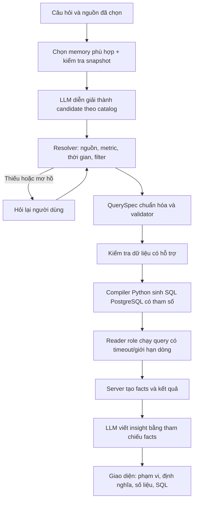

# Kiến trúc Texa hiện tại

Cập nhật 05/11/2026. Đặc tả scope ở [PRODUCT_SCOPE](PRODUCT_SCOPE.md); triển khai trong `backend/texa/`, không có LLM sinh SQL tự do ở pipeline Texa.

## Dữ liệu và định nghĩa

Adapter Cosmetics và Olist đã viết trước đưa dữ liệu về event rows PostgreSQL. Đây là hai ánh xạ cụ thể, không phải ETL hiểu mọi database. `analytics.source_registry` và vocabulary mô tả nguồn, khoảng ngày, event/field/value được ghi nhận. Profiler khám phá nested scalar tối đa hai key; không flatten/expand array tùy ý.

Catalog `catalog/product_events.yaml` được validate rồi publish vào `app.catalog_versions`. File YAML thay đổi không tự thay catalog đã publish. `scoped_sources` chỉ cho phép Cosmetics, Olist và fixture `event_benchmark`; `max_sources=1` giới hạn từng query. Catalog legacy lớn hơn chỉ phục vụ regression.

Cosmetics `purchase` và Olist `order_purchased` cùng là item purchase. Revenue lọc role purchase nên không cộng payment event của Olist. Coverage kiểm tra event và field từng nguồn; thiếu session/view thì từ chối hoặc báo unavailable, không suy diễn số 0.

## Luồng một câu hỏi

`answer.py` điều phối; `interpret.py` dựng context/catalog và gọi model; `clarify.py` resolver; `spec.py` validate; `sanity.py` kiểm tra availability; `compile.py` sinh SQL; `execute.py` chạy PostgreSQL; `facts.py`, `derive.py`, `insight.py` xử lý và trình bày số liệu. QuerySpec hợp lệ không đảm bảo model đã hiểu đúng ý định; phải đo kết quả thực thi trên đáp án chuẩn.

Không có bước sqlglot AST sandbox, DuckDB hay vòng self-correction free SQL trong kiến trúc sản phẩm này. Baseline đánh giá mới là LLM sinh SQL trực tiếp.

## Memory hội thoại

Memory có cấu trúc lưu truy vấn thành công, metric/nguồn/kỳ/filter/breakdown và provenance tới lượt hỏi. Câu xã giao hoặc lỗi không ghi đè truy vấn thành công. Pending clarification tách khỏi state đã commit.

Hệ thống chọn lượt liên quan theo tín hiệu ngôn ngữ/tham chiếu, thay vì chỉ lấy sáu tin gần nhất. Hỗ trợ “kết quả đó”, thêm điều kiện và tham chiếu rõ “câu đầu/câu thứ N/kết quả thứ N”. Câu hỏi được đếm theo lịch sử gốc; kết quả chỉ tính các câu trả lời thành công tương thích. Không tìm thấy hoặc có nhiều đối tượng thì hỏi lại; không tự thay bằng một kết quả khác.

Context gửi model vẫn có giới hạn token/số lượt được chọn. Việc truy hồi từ toàn lịch sử không đồng nghĩa đưa toàn lịch sử vào prompt, và không bảo đảm hiểu mọi cách diễn đạt. Snapshot/catalog thay đổi chặn thừa kế hoặc chạy lại kết quả cũ; retry/edit/switch metric replay memory để giữ nhất quán. M6 và M0 là ablation, không phải mặc định sản phẩm.

## Website nhiều người

FastAPI trả tiến trình qua SSE; React hiển thị bảng, scope, insight, SQL và lịch sử. Frontend chờ bootstrap thiết lập cookie, chống chèn kết quả vào nhầm chat khi chuyển hội thoại, và hủy follower khi không còn dùng.

Shared demo dùng cookie HttpOnly/SameSite và hash owner để tách conversation/turn API. Model settings/usage yêu cầu admin token; người tham gia không đổi model qua UI hay request tùy ý. Đây là phiên ẩn danh trong browser profile, không phải tài khoản người dùng. Mất cookie mất quyền xem lịch sử cũ.

RUNS/SSE nằm trong một process, chạy một worker; chưa hỗ trợ nhiều replica hoặc queue phân tán. HTTPS và giới hạn chi phí gateway cần cấu hình ở máy triển khai. Xem [demo checks](CLASS_DEMO_CHECKS.md).
