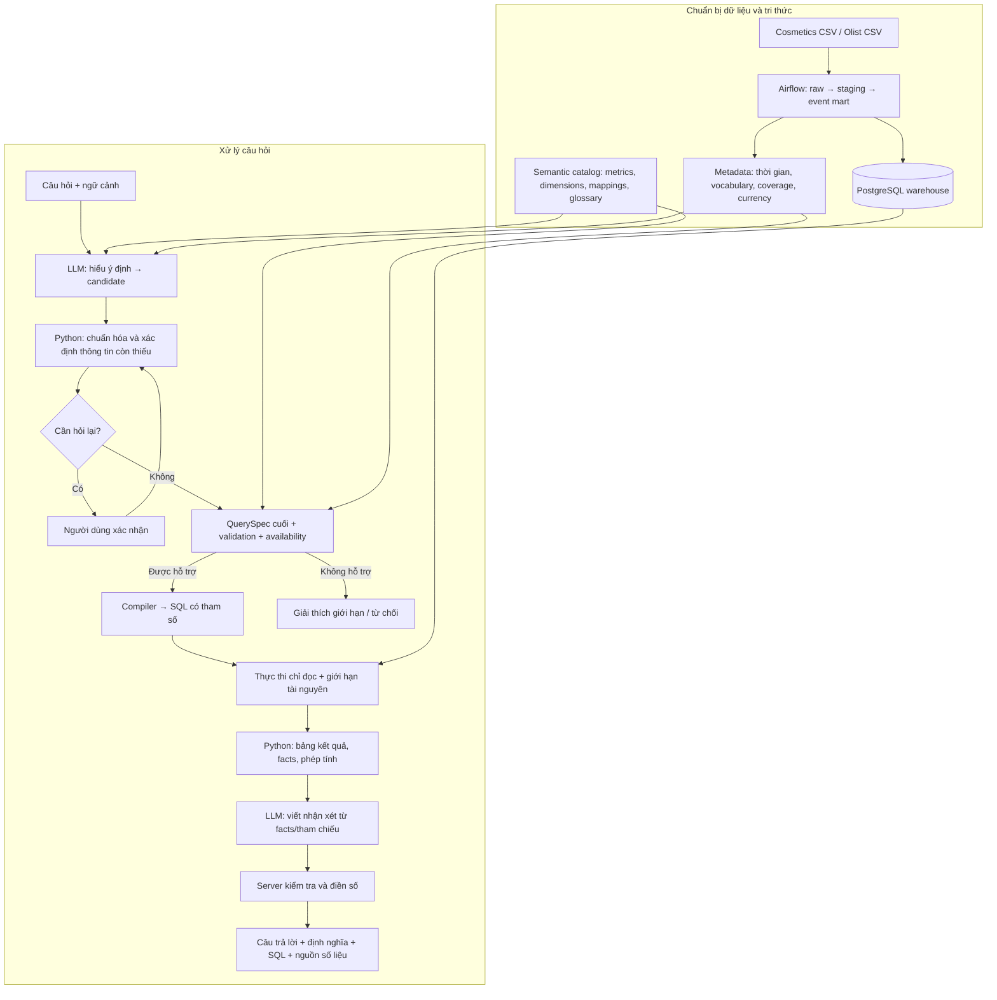

# Texa — Kịch bản thuyết trình theo hướng đề xuất nghiên cứu

**Thông điệp xuyên suốt:** Làm thế nào để người dùng hỏi dữ liệu e-commerce bằng ngôn ngữ tự nhiên, trong khi cách hiểu câu hỏi, cách tính và các con số trả lời đều có thể kiểm tra?

**Cách sử dụng:** Tiêu đề và mục “Trên slide” dùng để làm slide; mục “Lời thuyết trình” có thể đọc và luyện nói trực tiếp. Các ghi chú, nguồn và phụ lục dùng để chuẩn bị trả lời phản biện, không cần đọc toàn bộ trước lớp.

## Quy ước để bài nói đúng với kịch bản proposal

- Trình bày Texa như **hệ thống được đề xuất**. Dùng “chúng tôi đề xuất”, “dự kiến”, “sẽ kiểm tra”; không chuyển các mô tả implementation thành tuyên bố thực nghiệm.
- “Results” ở phần 5 gồm **kết quả đã công bố của công trình trước**, **findings khi khảo sát tài liệu/schema**, và **thí nghiệm được thiết kế từ các findings đó**. Thiết kế thí nghiệm chưa phải kết quả thí nghiệm.
- Những ví dụ có số như 60/63, 100 → 120 hoặc tỷ giá 3,2 là **minh họa**, không phải kết quả đo Texa.
- Bộ 63 câu trong tài liệu đánh giá được dùng như **tài sản chuẩn bị cho thiết kế evaluation**. Chưa có báo cáo live golden được xác minh để đưa thành thành tích của proposal.
- Phân biệt **research gap của project** với tuyên bố “chưa ai trên thế giới làm”. QuerySpec, intermediate representation, clarification và semantic layer đều có tiền lệ.
- Kịch bản này thay mạch trình bày của [OUTLINE.md](OUTLINE.md) cho buổi nói theo yêu cầu mới. Hai tài liệu [LITERATURE_REVIEW.md](LITERATURE_REVIEW.md) và [EVALUATION_METHODS.md](EVALUATION_METHODS.md) mô tả cả repo hiện tại; khi dùng nội dung từ đó phải giữ đúng quy ước proposal trên.

## Mạch bài và thời lượng

Bản đầy đủ có **24 slide**, phù hợp khoảng **28–32 phút** nếu trình bày cả ví dụ. Nếu giới hạn 18–20 phút, dùng bản rút gọn ở cuối tài liệu; không cần nói nhanh để đọc hết bản đầy đủ.

| Phần bắt buộc | Slide | Câu hỏi phần này trả lời | Thời gian gợi ý |
|---|---|---|---|
| 1. Problem statement, goals, scope, assumptions | 1–3 | Chúng ta cần giải quyết điều gì, trong điều kiện nào? | 3 phút |
| 2. Literature review + best practices | 4–8 | Đã có những cách nào, mạnh/yếu ở đâu, học được gì? | 6 phút |
| 3. Available datasets: compare and contrast | 9–11 | Dùng dữ liệu nào, vì sao, phải chuẩn bị ra sao? | 4 phút |
| 4. Evaluation methods | 12–15 | Làm sao biết đề xuất có hiệu quả? | 5 phút |
| 5. Results from previous work | 16–18 | Bằng chứng hiện có cho phép kết luận gì và cần thử gì tiếp? | 4 phút |
| 6. Proposed methods | 19–24 | Từ các căn cứ trên, Texa được thiết kế như thế nào? | 7 phút |

---

# 1. Problem statement, goals, scope, assumptions

## Slide 1 — Một câu hỏi ngắn, nhiều quyết định ẩn

### Trên slide

> “Doanh thu tháng trước của cửa hàng là bao nhiêu?”

- Doanh thu hàng hóa hay số tiền thanh toán?
- Cửa hàng nào? Tháng nào trong dữ liệu lịch sử?
- Theo tiền tệ nào? Có đủ dữ liệu để tính không?
- Làm sao kiểm tra con số trong câu trả lời?

### Lời thuyết trình

“Chúng em bắt đầu từ một nhu cầu rất quen thuộc: người làm kinh doanh muốn hỏi dữ liệu mà không phải tự viết SQL. Ví dụ, họ hỏi doanh thu tháng trước của cửa hàng là bao nhiêu.

Câu này ngắn, nhưng để trả lời đúng, hệ thống phải giải quyết nhiều việc. Doanh thu là tổng giá hàng hóa hay tổng tiền thanh toán? Người dùng đang nói đến cửa hàng nào? Nếu dữ liệu chỉ có đến năm 2020 thì tháng trước được hiểu theo hôm nay hay theo thời điểm cuối của dataset?

Ngay cả khi tạo được SQL chạy thành công, hệ thống vẫn có thể chọn sai định nghĩa hoặc sai thời gian. Và nếu phần diễn giải đưa thêm một con số không có trong kết quả, người dùng sẽ khó phát hiện.

Vì vậy, vấn đề chúng em muốn giải quyết là chuyển câu hỏi thành một câu trả lời phân tích có thể kiểm tra được cả về ý nghĩa lẫn số liệu.”

**Chuyển ý:** “Từ tình huống đó, chúng em xác định các câu hỏi nghiên cứu và tiêu chí thành công.”

## Slide 2 — Mục tiêu và câu hỏi nghiên cứu

### Trên slide

**Problem:** hỏi dữ liệu e-commerce đa nguồn bằng ngôn ngữ tự nhiên, với định nghĩa nghiệp vụ nhất quán và kết quả có thể kiểm tra.

| Câu hỏi nghiên cứu | Điều cần đo |
|---|---|
| RQ1. Hiểu đúng và tính đúng trong phạm vi hỗ trợ đến mức nào? | Ý định, kết quả, coverage |
| RQ2. Có kiểm soát được mơ hồ, thiếu dữ liệu và diễn giải thiếu căn cứ không? | Clarification/refusal, numerical correctness, faithfulness |
| RQ3. Chi phí của các bước kiểm soát có chấp nhận được không? | Latency, tokens, chi phí |

### Lời thuyết trình

“Chúng em đặt ra ba câu hỏi nghiên cứu.

Thứ nhất, hệ thống có hiểu đúng yêu cầu và tính đúng kết quả trên các câu hỏi thuộc phạm vi hỗ trợ không? Ở đây cần đo cả tỷ lệ đúng và tỷ lệ câu hỏi được trả lời, để tránh một hệ thống chỉ từ chối thật nhiều rồi có vẻ an toàn.

Thứ hai, khi người dùng hỏi mơ hồ hoặc nguồn không có dữ liệu, hệ thống có biết hỏi lại hoặc giải thích giới hạn không? Sau khi có kết quả, phần nhận xét có bám vào số liệu và đúng đơn vị không?

Thứ ba, các bước kiểm soát đó làm tăng thời gian và chi phí bao nhiêu? Một thiết kế tốt hơn về chất lượng nhưng quá chậm cũng cần được cân nhắc.

Mục tiêu của chúng em là đo các khía cạnh này riêng biệt. Chúng em chưa đặt giả định rằng một kiến trúc nhiều bước chắc chắn tốt hơn.”

## Slide 3 — Phạm vi và những giả định phải công khai

### Trên slide

- **Trong phạm vi:** tiếng Việt/Anh; dữ liệu lịch sử; hai nguồn e-commerce; aggregate, breakdown, trend và hỏi tiếp có giới hạn.
- **Ngoài phạm vi ban đầu:** SQL tùy ý, ghi/sửa dữ liệu, dự báo, suy luận nhân quả, lợi nhuận/ROAS khi thiếu dữ liệu đầu vào.
- **Giả định:** có người chịu trách nhiệm định nghĩa metric; có snapshot dữ liệu và metadata; chỉ trả lời trong khả năng dữ liệu.
- **Thời gian:** “N ngày gần nhất” neo vào ngày cuối của từng nguồn và phải hiển thị mốc đó.

### Lời thuyết trình

“Để bài toán khả thi, chúng em giới hạn giai đoạn đầu vào phân tích dữ liệu lịch sử của hai nguồn e-commerce. Người dùng có thể hỏi tiếng Việt hoặc tiếng Anh, xem tổng, chia theo nhóm, theo thời gian và hỏi tiếp dựa trên ngữ cảnh.

Chúng em chưa hướng tới mọi truy vấn SQL hoặc phân tích nhân quả. Chẳng hạn, nếu dữ liệu không có chi phí thì không thể trả lời lợi nhuận ròng; nếu không có chi phí quảng cáo thì không thể tính ROAS.

Một giả định quan trọng là có người hiểu nghiệp vụ xác nhận định nghĩa chỉ số. Hệ thống cũng cần biết mỗi nguồn ghi nhận những gì và dữ liệu đến ngày nào. Với dữ liệu lịch sử, bảy ngày gần nhất sẽ được tính đến ngày cuối của nguồn và ghi rõ trong câu trả lời.

Đây là phạm vi để đánh giá đề xuất, không phải cam kết xử lý mọi câu hỏi kinh doanh.”

**Chuyển sang phần 2:** “Sau khi xác định bài toán, chúng em khảo sát các hướng đã được nghiên cứu để biết nên kế thừa điều gì và cần kiểm chứng điều gì.”

# 2. Literature review + best practices

## Slide 4 — Tương tác với người dùng và học ánh xạ ngôn ngữ–schema

### Trên slide

| Hướng / đại diện | Cơ chế chính | Strength | Drawback |
|---|---|---|---|
| NaLIR, 2014 [R1] | Ánh xạ câu hỏi → query tree; người dùng xác nhận/chỉnh | Làm rõ mơ hồ, thể hiện cách hiểu | Phụ thuộc parser/mapping; thêm thao tác |
| RAT-SQL, 2020 [R2] | Học quan hệ giữa câu hỏi và schema | Schema linking, tổng quát hóa schema | Cần huấn luyện; vẫn có thể chọn sai logic |
| IRNet, 2019 [R3] | Neural parser → SemQL → SQL | Tách ý định khỏi chi tiết SQL | Phụ thuộc dữ liệu, grammar và chất lượng linking |

### Lời thuyết trình

“Hướng đầu tiên chúng em xem xét là giao diện truy vấn có tương tác. NaLIR phân tích câu hỏi, ánh xạ sang schema, tạo query tree và cho người dùng sửa những chỗ chưa rõ. Bài học ở đây là không cần đoán mọi thứ ngay từ đầu; người dùng có thể tham gia xác nhận ý định. Đổi lại, hệ thống phụ thuộc parser và phải thêm bước tương tác.

Với các mô hình học có giám sát, RAT-SQL tập trung biểu diễn quan hệ và liên kết giữa câu hỏi với schema. IRNet sử dụng biểu diễn trung gian SemQL rồi chuyển sang SQL. Điểm đáng chú ý của IRNet là mô hình không nhất thiết phải sinh toàn bộ SQL trực tiếp.

Các hướng này cung cấp nền tảng tốt về schema linking và biểu diễn có cấu trúc. Tuy nhiên, grammar hợp lệ hoặc schema linking tốt vẫn chưa bảo đảm truy vấn chọn đúng định nghĩa doanh thu mà doanh nghiệp mong muốn.”

**Ghi chú:** Không gom RAT-SQL/IRNet vào nhóm rule-based; không mô tả NaLIR là chỉ hỗ trợ template đơn giản.

## Slide 5 — LLM prompting và workflow phân rã

### Trên slide

| Hướng / đại diện | Cơ chế | Strength | Drawback |
|---|---|---|---|
| DAIL-SQL, 2024 [R4] | Biểu diễn schema; chọn và tổ chức few-shot examples | Tận dụng LLM có sẵn; linh hoạt; xét token efficiency | Nhạy với context; có thể hiểu sai nghiệp vụ |
| DIN-SQL, 2023 [R5] | Linking → phân rã → sinh SQL → sửa lỗi | Xử lý riêng các nguồn lỗi | Nhiều bước; tốn calls; lỗi có thể lan truyền |

**Bài học:** chất lượng context và cách chia việc đều đáng đánh giá; thêm bước không tự bảo đảm đúng.

### Lời thuyết trình

“Với LLM, một hướng phổ biến là cung cấp schema và ví dụ để mô hình tạo SQL. DAIL-SQL nghiên cứu cách biểu diễn đầu vào, lựa chọn ví dụ và tổ chức prompt, đồng thời cân nhắc hiệu quả token. Ưu điểm là có thể khai thác mô hình có sẵn mà không cần huấn luyện một parser từ đầu cho project.

DIN-SQL đi theo workflow phân rã: liên kết schema, phân loại và phân rã bài toán, tạo SQL rồi sửa lỗi. Cách này cho thấy việc tách tác vụ thành các bước có thể hữu ích, nhưng tăng số lần gọi và không loại bỏ hoàn toàn lỗi ngữ nghĩa.

Từ hai công trình, chúng em rút ra rằng cần cung cấp context phù hợp và xác định rõ trách nhiệm từng bước. Tuy nhiên, chúng em không suy ra rằng cứ thêm nhiều bước hoặc cho model tự sửa là hệ thống sẽ đúng hơn; điều đó cần baseline và ablation.”

## Slide 6 — Semantic layer: thống nhất cách tính trước khi hỏi

### Trên slide

**Tham khảo kiến trúc:** dbt Semantic Layer / MetricFlow [R7, R8].

```text
Định nghĩa metrics + dimensions + quan hệ
                    ↓
              Metric request
                    ↓
            Query planning → SQL
```

- **Strength:** dùng lại định nghĩa; có đường truy từ yêu cầu tới công thức.
- **Drawback:** chi phí mô hình hóa; giới hạn biểu đạt; định nghĩa/compiler vẫn có thể sai.
- **Loại bằng chứng:** tài liệu kiến trúc công nghiệp, không phải kết quả thực nghiệm chứng minh ưu thế cho Texa.

### Lời thuyết trình

“Một hướng kiến trúc khác là semantic layer. Thay vì mỗi câu hỏi tự quyết định lại doanh thu hoặc số đơn được tính thế nào, tổ chức định nghĩa metric và dimensions tập trung. MetricFlow nhận yêu cầu metric, lập kế hoạch và tạo SQL từ những định nghĩa đó.

Điểm mạnh là tính nhất quán và khả năng kiểm tra công thức. Khi đặt một lớp hiểu ngôn ngữ phía trước, mô hình có thể chọn khái niệm nghiệp vụ đã công bố thay vì tự viết lại mọi phép tính.

Đổi lại, nhóm phát triển phải xây dựng và bảo trì các định nghĩa. Những câu hỏi ngoài mô hình được hỗ trợ sẽ khó trả lời hơn, và compiler vẫn cần kiểm thử.

Chúng em dùng đây làm tiền lệ về kiến trúc. Tài liệu công nghiệp này không phải bằng chứng rằng semantic layer kết hợp LLM chắc chắn tăng độ chính xác trên dữ liệu của chúng em.”

## Slide 7 — Ràng buộc đúng cấu trúc khác với hiểu đúng câu hỏi

### Trên slide

| Kỹ thuật | Kiểm soát điều gì? | Chưa chứng minh điều gì? |
|---|---|---|
| Schema/semantic linking | Gắn từ ngữ với dữ liệu/khái niệm | Chọn đúng ý định ở mọi câu hỏi |
| Intermediate representation | Biểu diễn rõ các lựa chọn | Các lựa chọn đó đều đúng |
| PICARD [R6] | Ràng buộc token bằng incremental parsing | Đúng nghiệp vụ |
| Structured JSON + validation | Đúng schema, ID và tổ hợp được hỗ trợ | Đúng nguồn, kỳ thời gian theo ý người hỏi |
| Context/example selection | Giảm context không liên quan | Không bỏ sót thông tin cần thiết |

### Lời thuyết trình

“Có một phân biệt quan trọng trong literature: hợp lệ về cấu trúc khác với đúng về ý nghĩa.

PICARD dùng incremental parsing để loại các token không hợp lệ trong quá trình sinh. Structured output theo JSON schema kiểm soát một dạng đầu ra khác. Hai kỹ thuật có cùng mục tiêu chung là hạn chế đầu ra sai cấu trúc, nhưng không phải cùng một thuật toán.

Ví dụ, một yêu cầu có metric doanh thu, nguồn Olist và năm 2019 có thể hoàn toàn hợp lệ về cấu trúc. Nhưng nếu người dùng hỏi năm 2018 thì nó vẫn sai.

Vì vậy, chúng em tách ba mức: đúng cấu trúc, đúng ý định và kết quả nghiệp vụ, rồi đến đúng diễn giải. Không lấy thành công ở mức đầu làm bằng chứng cho cả ba.”

## Slide 8 — Best practices và khoảng trống thiết kế của project

### Trên slide

| Best practice được chọn | Căn cứ | Điều phải kiểm chứng |
|---|---|---|
| Ground câu hỏi vào khái niệm và định nghĩa cụ thể | Schema linking; semantic layer | Có chọn đúng metric/nguồn không? |
| Có cấu trúc trung gian và hỏi lại khi cần | NaLIR; IRNet | Có giảm sai ý định mà không hỏi quá nhiều? |
| Kiểm soát thực thi và giữ nguồn của số liệu | Thực hành kỹ thuật hệ thống | Có tính đúng, diễn giải đúng không? |
| Đánh giá từng lớp, cùng latency/cost | Tổng hợp evaluation [R12] | Lợi ích có đáng chi phí không? |

**Workflow ở mức nguyên tắc:** hiểu yêu cầu → xác nhận khả năng → thực thi có kiểm soát → giải thích dựa trên kết quả.

### Lời thuyết trình

“Từ phần review, chúng em chọn bốn thực hành phù hợp với phạm vi của project.

Thứ nhất, gắn câu hỏi với các định nghĩa cụ thể. Thứ hai, dùng một biểu diễn trung gian để kiểm tra lựa chọn của mô hình, và hỏi lại ở những điểm mơ hồ. Thứ ba, kiểm soát việc chạy truy vấn và lưu nguồn gốc các con số. Thứ tư, đo riêng từng lớp cùng thời gian và chi phí.

Hai thực hành đầu có tiền lệ trực tiếp trong các nghiên cứu và kiến trúc đã trình bày. Kiểm soát quyền thực thi và truy vết số liệu là quyết định kỹ thuật hệ thống của project; chúng em không gán toàn bộ những thực hành này thành kết quả của một paper.

Khoảng trống cần giải quyết trong phạm vi chúng em là kết hợp các thành phần đó cho dữ liệu e-commerce không đồng nhất và kiểm tra hiệu quả bằng một protocol rõ ràng. Đây chưa phải khẳng định rằng tổ hợp này tối ưu hoặc chưa từng có.”

**Chuyển sang phần 3:** “Để biết workflow này cần xử lý những khác biệt nào, bước tiếp theo là lựa chọn và khảo sát dữ liệu.”

# 3. Available datasets: compare and contrast

## Slide 9 — Benchmark nghiên cứu và dữ liệu ứng dụng có vai trò khác nhau

### Trên slide

| Dataset | Đặc trưng | Giá trị với proposal | Giới hạn khi áp dụng trực tiếp |
|---|---|---|---|
| Spider [R9] | Nhiều domain/schema; cặp NL–SQL | Tham khảo cross-domain evaluation | Chưa bao phủ trọn hội thoại BI và diễn giải |
| BIRD [R10] | Dữ liệu lớn, giá trị dữ liệu, external knowledge | Tham khảo data grounding và execution | Không thay thế metric contract của e-commerce |
| Spider 2.0 [R11] | Workflow doanh nghiệp; schema lớn; tài liệu/code | Cho thấy nhu cầu đánh giá ngoài truy vấn đơn | Phạm vi rộng hơn đề xuất ban đầu |
| Cosmetics + Olist [D1, D2] | Dữ liệu nghiệp vụ không có sẵn nhãn NL–SQL | Thiết kế câu hỏi và kiểm tra nghiệp vụ cụ thể | Phải tự xây nhãn, SQL tham chiếu và protocol |

### Lời thuyết trình

“Chúng em phân biệt hai mục đích dùng dataset.

Spider hỗ trợ nghiên cứu tổng quát hóa sang schema khác. BIRD nhấn mạnh dữ liệu thực tế, nội dung database và kiến thức bổ sung. Spider 2.0 mở rộng sang workflow doanh nghiệp, nơi có thể cần đọc tài liệu và xử lý nhiều bước.

Các benchmark này hữu ích để tham khảo phương pháp đánh giá. Hệ thống có compiler vẫn có thể được đánh giá bằng kết quả thực thi; không phải cứ dùng biểu diễn trung gian là không dùng được benchmark.

Tuy nhiên, câu hỏi của project còn gồm định nghĩa metric, nguồn thiếu event, hỏi lại và kiểm tra lời diễn giải. Vì vậy, chúng em chọn dữ liệu e-commerce để xây bộ đánh giá theo phạm vi đó. Đánh đổi là nhóm phải tự chuẩn bị ground truth, và kết quả nội bộ không thể so trực tiếp với điểm Spider hoặc BIRD.”

## Slide 10 — Vì sao chọn Cosmetics và Olist?

### Trên slide

| Tiêu chí | REES46 Cosmetics [D1] | Brazilian E-Commerce / Olist [D2] |
|---|---|---|
| Dạng gốc | Event log | Các bảng quan hệ |
| Tín hiệu chính | View, cart, remove cart, purchase; session; brand | Order, item, payment, review, delivery; bang/thành phố |
| Không quan sát được | Review, delivery, địa lý khách hàng | Lượt xem, giỏ hàng trước mua |
| Thời gian nguồn công bố | 10/2019–02/2020 | Đơn hàng giai đoạn 2016–2018 |
| Chọn ban đầu | 12/2019–01/2020 | Tập bảng nghiệp vụ đã chọn |
| Tiền tệ | USD | BRL |
| Đơn vị cần phân biệt | Event, user, session | Order, item line, payment, review |
| Thách thức kiểm tra | Session thay order; event ratio khác user funnel | Join fanout; thanh toán khác doanh thu hàng hóa |

**Quy mô nguồn tham khảo:** Cosmetics khoảng 20 triệu events cho toàn bộ 5 tháng; Olist khoảng 100 nghìn orders. Đây là mô tả nguồn, **không phải số dòng đã nạp hoặc đo trên snapshot của proposal**.

### Lời thuyết trình

“Hai nguồn được chọn vì chúng tạo ra những khác biệt có ý nghĩa cho bài toán.

Cosmetics là log hành vi: có xem sản phẩm, thêm giỏ và mua hàng. Olist là dữ liệu quan hệ: có đơn hàng, từng dòng sản phẩm, thanh toán, review và giao hàng. Olist không cho chúng ta biết số lượt xem hoặc thêm giỏ trước khi mua; Cosmetics lại không có review và giao hàng.

Vì vậy, không thể đưa ra cùng một danh sách metric rồi giả định nguồn nào cũng tính được. Chúng em cũng phải phân biệt event với order: một đơn Olist có nhiều sản phẩm và có thể có nhiều payment.

Hai nguồn còn khác thời kỳ và tiền tệ. Quy đổi BRL sang USD giúp thống nhất đơn vị tiền, nhưng không biến hai cửa hàng thành hai nhóm có cùng thị trường và cùng thời điểm. Các so sánh xuyên nguồn chỉ nên được diễn giải trong giới hạn đó.”

**Ghi chú khi làm slide:** Olist gốc có 9 CSV tính cả geolocation; thiết kế ban đầu chọn 8 CSV, dùng bang/thành phố có sẵn ở customers/sellers, không cần bảng geolocation. Không gọi “100 nghìn dòng” vì một order có thể sinh nhiều dòng/event.

## Slide 11 — ETL dự kiến và hợp đồng dữ liệu

### Trên slide

```text
CSV nguồn → Raw → Staging → Event mart thống nhất
                 ↓                  ↓
          Ép kiểu, dedupe,      Metadata + quality checks
          ghi nhận lỗi         → snapshot dùng để đánh giá
```

- Giữ `source_id`, event gốc, thời gian, user, item, giá/currency và thuộc tính liên quan.
- Chốt grain và chống đếm trùng trước khi tính metric.
- Metadata: khoảng ngày, event/field khả dụng, currency, tỷ lệ thiếu.
- Chất lượng ETL là tiền điều kiện; chưa phải độ chính xác model.

### Lời thuyết trình

“Trước khi đánh giá model, chúng em cần một dữ liệu nền ổn định. Pipeline dự kiến giữ bản raw, tạo staging để ép kiểu và xử lý trùng, rồi đưa dữ liệu cần thiết về một event mart thống nhất.

Với Olist, purchase được tạo ở mức dòng sản phẩm; payment và review được giữ ở grain của chúng. Nếu nối item và payment không đúng, doanh thu có thể bị nhân lên. Danh tính khách hàng Olist cần dựa vào customer unique ID, và user của hai nguồn không được coi là cùng một người chỉ vì trùng ID.

Pipeline cũng tạo metadata về ngày cuối, event, thuộc tính và tiền tệ. Chúng em dự kiến kiểm tra số dòng, khóa, giá trị thiếu, tính hợp lý của thời gian và đối chiếu tổng quan trọng với raw.

Về tiền tệ, khi cần so USD, BRL sẽ được quy đổi theo tỷ giá lịch sử có nguồn và snapshot rõ ràng. Nếu thiếu tỷ giá hoặc thiếu event cần thiết, hệ thống phải báo giới hạn thay vì âm thầm coi đó là số không.”

**Ghi chú kỹ thuật để trả lời:**

- Chốt quy tắc timezone trước khi tạo `event_date`. Timestamp Olist thiếu thông tin múi giờ không được mặc nhiên xem là đã chuyển UTC chính xác.
- FX tham khảo FRED `DEXBZUS`, đơn vị BRL cho 1 USD: `USD = BRL / rate`. Dự kiến dùng ngày giao dịch gần nhất trước đó trong cửa sổ tối đa 7 ngày; nếu vẫn thiếu thì đánh dấu thiếu. Giữ cả số tiền gốc và số tiền quy đổi [D3].
- Không nối toàn bộ bảng rồi mới aggregate. Chứng minh cardinality hoặc aggregate về grain phù hợp trước khi nối.
- Chỉ dedupe theo quy tắc có căn cứ; hai events giống thuộc tính chưa chắc là cùng một hành vi.
- Ghi rõ tiền hàng chưa gồm freight; payment value là metric khác. Kiểm tra giá bất thường thay vì xóa mọi event có giá không hợp lệ khỏi toàn bộ phân tích hành vi.
- `first_seen` là lần đầu xuất hiện trong cửa sổ dữ liệu, không phải ngày đăng ký thật. Cohort gần cuối dữ liệu cần đủ cửa sổ theo dõi mới chấm retention.
- Dự kiến dùng Airflow điều phối và PostgreSQL lưu trữ; ETL dữ liệu lịch sử không đòi hỏi pipeline thời gian thực.

**Chuyển sang phần 4:** “Khi dữ liệu và các giả định đã rõ, chúng em mới có cơ sở định nghĩa đáp án chuẩn và phương pháp đánh giá.”

# 4. Evaluation methods

## Slide 12 — Đánh giá riêng cách hiểu, cách tính và cách diễn giải

### Trên slide

| Lớp | Đối chiếu | Trả lời câu hỏi gì? |
|---|---|---|
| Data/ETL | Mart với raw, khóa, grain, tổng tham chiếu | Dữ liệu nền có đáng tin? |
| Intent & behavior | Hành vi và QuerySpec với nhãn thủ công | Có hiểu đúng và xử lý đúng tình huống? |
| Compiler | Kết quả SQL compiler với SQL tham chiếu; input spec chuẩn | Compiler có tính đúng? |
| End-to-end result | Kết quả từ câu hỏi với đáp án tham chiếu | Cả luồng có trả đúng bảng/số? |
| Answer & operations | Số, đơn vị, nhận xét, latency/tokens | Câu trả lời có căn cứ, chi phí ra sao? |

### Lời thuyết trình

“Chúng em đề xuất đánh giá theo từng lớp để biết lỗi đến từ đâu.

Đầu tiên là chất lượng dữ liệu. Tiếp theo, cho model đọc câu hỏi thật và đối chiếu hành vi cùng các lựa chọn truy vấn với nhãn do người viết.

Để kiểm tra riêng compiler, chúng em đưa vào một QuerySpec đã biết đúng, chạy SQL compiler tạo ra và so kết quả với SQL tham chiếu viết tay trên cùng snapshot. Đây là kiểm tra compiler, chưa đo model hiểu ngôn ngữ.

Sau đó, đánh giá end-to-end bắt đầu từ câu hỏi và so bảng trả về với bảng chuẩn. Cuối cùng là kiểm tra số và nhận xét trong câu trả lời, đồng thời đo độ trễ và token.

Chúng em ưu tiên so ý nghĩa và kết quả, không yêu cầu hai câu SQL phải giống từng ký tự.”

## Slide 13 — Golden eval: kiểm tra gì, và 60/63 có nghĩa gì?

### Trên slide

**Tài sản chuẩn bị:** 63 case Việt/Anh; có 7 case hỏi tiếp kèm ngữ cảnh.

```text
Câu hỏi → model thật + xử lý hệ thống → status + QuerySpec cuối
                                               ↕ đối chiếu
                          Kỳ vọng do con người khai báo
```

Ví dụ kỳ vọng: `answered`, `revenue`, `cosmetics_shop`, `item_category`, `2019-12-01…2019-12-31`.

**Ví dụ giả định:** `60 / 63 × 100 = 95,2%` case đạt các kỳ vọng được chấm.

**Giới hạn bộ chấm tham khảo:** đối chiếu một số trường; chưa phải toàn bộ QuerySpec, kết quả SQL hoặc toàn bộ nhận xét.

### Lời thuyết trình

“Golden eval là bộ câu hỏi đi kèm kỳ vọng do con người viết trước. Ví dụ, với câu doanh thu theo danh mục của Cosmetics trong tháng 12 năm 2019, chúng em ghi rõ metric, nguồn, dimension và khoảng thời gian đúng.

Khi chạy, model thật tạo cách hiểu ban đầu; hệ thống xử lý thành QuerySpec cuối. Bộ chấm so trạng thái và các trường được khai báo với kỳ vọng đó. Vì vậy, nói chính xác là đối chiếu hành vi và các thành phần ý định sau xử lý, không phải chỉ so JSON thô của AI.

Giả sử 60 trong 63 case pass thì tỷ lệ là 95,2%. Ba case fail là ba case bị phát hiện ít nhất một vi phạm trong những điều được chấm. Một case sai nhiều trường vẫn chỉ tính một fail.

Nhưng tỷ lệ này chỉ phản ánh các kỳ vọng đã kiểm tra. Nếu một case không khai báo nguồn hoặc năm, bộ chấm có thể bỏ sót sai nguồn hoặc sai năm. Nó cũng chưa chứng minh mọi con số và mọi câu nhận xét đều đúng. Ví dụ 60 trên 63 ở đây chỉ để giải thích cách tính.”

**Ví dụ mở rộng khi bị hỏi:**

| Trường | Đúng theo câu hỏi | Output giả định | Nếu `expect` chỉ có status/metric/dimension |
|---|---|---|---|
| Status | answered | answered | Khớp |
| Metric | revenue | revenue | Khớp |
| Dimension | event_month | event_month | Khớp |
| Nguồn | Olist | Cosmetics | Không được kiểm tra |
| Năm | 2018 | 2019 | Không được kiểm tra |

Case minh họa vẫn có thể pass. **Đây là giới hạn của việc chấm một phần, không phải kết quả thực nghiệm.**

## Slide 14 — Xây ground truth và chấm kết quả như thế nào?

### Trên slide

1. Chốt metric contract và snapshot dữ liệu.
2. Viết câu hỏi, hành vi đúng, trường ngữ nghĩa và SQL/kết quả tham chiếu khi có thể trả lời.
3. Review nhãn trước khi chạy model; tách development và held-out test.
4. So kết quả có quy tắc về nhóm, thứ tự, NULL, số thực và đơn vị.
5. Chấm riêng numerical correctness và answer faithfulness.

**63 case là seed regression, không mặc nhiên là benchmark độc lập.** Phương án held-out cụ thể để thảo luận: 120 case mới, xem phụ lục E.

### Lời thuyết trình

“Để biến golden eval thành bằng chứng mạnh hơn, chúng em đề xuất chốt định nghĩa metric và dữ liệu trước khi gán nhãn. Với mỗi câu hỏi, người gán nhãn xác định phải trả lời, hỏi lại hay từ chối; nếu trả lời thì ghi rõ ý định và chuẩn bị SQL hoặc kết quả tham chiếu.

Chúng em sẽ bổ sung bộ test độc lập. Những câu dịch Việt–Anh, paraphrase và câu trong cùng một hội thoại phải được giữ cùng một nhóm khi chia tập, để tránh một biến thể nằm ở prompt còn biến thể gần giống nằm ở test.

Về kết quả, nếu thứ tự không phải yêu cầu của câu hỏi thì so theo khóa nhóm; nếu là top-k thì thứ tự phải được kiểm tra. Counts cần khớp chính xác; số thực dùng ngưỡng sai số đã chốt. NULL, bằng không và không có dòng không được coi là một.

Phần nhận xét sẽ được chấm riêng: con số, đơn vị, kỳ thời gian và kết luận có được kết quả hỗ trợ không? Một lời giải thích nguyên nhân không có bằng chứng vẫn là vấn đề, kể cả khi nó không chứa số.”

**Cam kết thiết kế bộ chấm — chưa phải tính năng đã triển khai:**

- Bắt buộc spec ở case cần trả lời; kiểm tra các trường ngữ nghĩa quan trọng, operator và filter dư; xác định khi nào chấp nhận nhiều cách hiểu.
- Chuẩn hóa trước khi so: thứ tự filters/dimensions nếu không có ý nghĩa; mặc định thời gian; biểu diễn metric đơn và danh sách metric tương đương. Không dùng raw JSON exact match để phạt khác biệt hình thức.
- Các trường như shape, time field, limit/top-k được chấm khi ảnh hưởng câu hỏi. Không mặc nhiên bỏ qua limit nếu người dùng yêu cầu “top 5”.
- Reference SQL phải được review và đối chiếu tổng/fixture nhỏ, tránh viết lại cùng một lỗi của compiler. Kết quả khớp trên một snapshot vẫn có thể trùng hợp, nên bổ sung fixture phân biệt các logic dễ nhầm.
- Dự kiến hai người chấm độc lập một rubric faithfulness, báo mức đồng thuận và giải quyết bất đồng; LLM judge chỉ là hỗ trợ nếu dùng.
- Với clarification, ngoài đo hỏi đúng field, cần kịch bản trả lời form rồi chấm kết quả sau khi tiếp tục.

## Slide 15 — Protocol so sánh và các chỉ số sẽ báo cáo

### Trên slide

- **Baseline:** cùng LLM sinh SQL trực tiếp, cùng dữ liệu và định nghĩa nghiệp vụ được cung cấp.
- **Proposed:** workflow có cấu trúc trung gian và các bước kiểm soát.
- **Đo:** intent correctness, result correctness, answerable success/coverage, xử lý mơ hồ/không hỗ trợ, faithfulness, p50/p95 latency và tokens.
- **Lặp:** dự kiến 3 lần; log từng case, lỗi và cấu hình.
- **Ablation:** bỏ từng thành phần có giả thuyết rõ ràng; không suy diễn trước kết quả.

### Lời thuyết trình

“Để trả lời đề xuất có đáng làm không, chúng em cần baseline. Baseline chính là cùng một LLM được yêu cầu tạo SQL trực tiếp. Nó phải được cung cấp cùng dữ liệu và định nghĩa nghiệp vụ liên quan; nếu chỉ Texa được xem định nghĩa đúng thì phép so sánh sẽ không còn công bằng.

Chúng em sẽ báo cả tỷ lệ trả đúng trên các câu có thể trả lời, coverage, và khả năng hỏi lại hoặc từ chối đúng. Từ chối một câu hoàn toàn trả lời được phải được ghi nhận là thất bại, không phải thành công an toàn.

Các lần chạy được lặp theo cùng cấu hình để xem độ ổn định. Ngoài chất lượng, chúng em đo độ trễ từ câu hỏi đến câu trả lời hoàn chỉnh, token và chi phí. Nếu một thành phần làm tăng chất lượng nhưng tăng nhiều thời gian, đó là trade-off cần công bố.

Cuối cùng, ablation sẽ giúp xác định thành phần nào đóng góp. Kết quả tổng của hai hệ thống không tự giải thích được vì sao chúng khác nhau.”

**Ghi chú báo cáo:** Với 63 case × 3 lần có 189 lượt chấm, nhưng không phải 189 câu độc lập. Phân tích bất định và so sánh nên giữ nhóm theo case/hội thoại. Ghi cả số mẫu của từng nhóm, model/version, temperature, prompt/catalog hash, snapshot dữ liệu, token budget và ngày chạy; không chỉ báo một phần trăm tổng.

**Chuyển sang phần 5:** “Trước khi chốt kiến trúc, chúng em tổng hợp những gì bằng chứng hiện có thực sự cho phép kết luận.”

# 5. Results: findings và experiments từ previous work

## Slide 16 — Kết quả đã công bố: có tiến bộ, vẫn cần kiểm tra theo bối cảnh

### Trên slide

| Công trình | Kết quả paper báo cáo | Finding dùng cho proposal |
|---|---|---|
| DIN-SQL [R5] | 85,3% execution accuracy trên Spider test; 55,9% trên BIRD test | Workflow phân rã có bằng chứng thực nghiệm trong setup của paper |
| DAIL-SQL [R4] | 86,6% execution accuracy trên Spider leaderboard | Prompt/context/example design có giá trị nghiên cứu |
| Spider 2.0 [R11] | Agent dùng o1-preview giải được 21,3% tác vụ trong setup paper | Cần đánh giá workflow thực tế, không chỉ SQL đơn |

**Không phải:** điểm của Texa; SOTA hiện tại; thí nghiệm cùng điều kiện; bằng chứng semantic layer tốt hơn một lượng xác định.

### Lời thuyết trình

“Về kết quả công bố, DIN-SQL báo cáo 85,3% execution accuracy trên Spider test và 55,9% trên BIRD test. DAIL-SQL báo cáo 86,6% trên Spider leaderboard. Đây là bằng chứng rằng thiết kế workflow và prompt có thể đem lại kết quả tốt trong điều kiện của các nghiên cứu đó.

Ở Spider 2.0, paper báo cáo agent sử dụng o1-preview giải được 21,3% tác vụ trong setup của họ. Kết quả này nhắc chúng em rằng workflow doanh nghiệp tạo thêm các yêu cầu ngoài một câu truy vấn riêng lẻ.

Những con số này không phải bảng xếp hạng hiện tại, cũng không cho phép kết luận DAIL-SQL hơn DIN-SQL nhờ duy nhất một kỹ thuật. Dataset, model và cấu hình khác nhau. Chúng em cũng không lấy chênh lệch điểm giữa các benchmark làm mức cải thiện mà Texa sẽ đạt.

Finding đủ chắc để sử dụng là: cần đánh giá phương pháp trong đúng dữ liệu và nhiệm vụ mục tiêu, với baseline cùng điều kiện.”

**Nguồn và phạm vi:** DIN-SQL: NeurIPS 2023, abstract bản v3; DAIL-SQL: PVLDB 2024, abstract bản v4; Spider 2.0: paper ICLR 2025, abstract bản v2. Không chuyển “21,3% trong setup này” thành “mọi model hiện tại chỉ đạt 21,3%”. Không dùng số GPT-4/ChatGPT thiếu attribution từ outline cũ.

## Slide 17 — Findings của nhóm từ khảo sát dữ liệu và thiết kế evaluation

### Trên slide

| Finding sơ bộ | Bằng chứng / loại bằng chứng | Hệ quả thiết kế |
|---|---|---|
| Cùng khái niệm nhưng event khác tên | Schema/mapping dự kiến: `purchase`, `order_purchased` | Cần mapping ngữ nghĩa |
| Nguồn không có cùng khả năng quan sát | Olist thiếu view/cart; Cosmetics thiếu review | Cần kiểm tra khả dụng, không trả zero |
| Đếm đúng cần biết grain | Orders, items, payments; session chỉ là proxy | Metric contract + kiểm thử compiler |
| Cùng đơn vị chưa đủ để so công bằng | Khác thời kỳ, population; USD/BRL | Hiển thị phạm vi và giả định |
| Pass một số trường không chứng minh đúng cả câu trả lời | Rà soát thiết kế bộ 63 case và scorer tham khảo | Bổ sung result/faithfulness evaluation |

### Lời thuyết trình

“Phần previous work của nhóm ở giai đoạn này là khảo sát dữ liệu và chuẩn bị thiết kế đánh giá, chưa phải một thí nghiệm chứng minh Texa tốt hơn.

Chúng em thấy một hành động mua hàng có thể có tên khác nhau giữa các nguồn. Quan trọng hơn, có những hành vi một nguồn hoàn toàn không ghi nhận. Olist không có lượt thêm giỏ, nên không thể xem số lượt thêm giỏ của Olist là không.

Chúng em cũng thấy định nghĩa số đơn không thể sao chép máy móc: Olist có order ID, còn Cosmetics phải dùng session có purchase làm đại diện nếu muốn có một metric gần tương ứng. Nhãn và diễn giải phải nói rõ đây là proxy.

Về đánh giá, kiểm tra một vài trường trong spec không đủ để chứng minh bảng số liệu hoặc lời nhận xét đúng. Những findings này giúp chúng em xác định thành phần cần có và loại thí nghiệm cần làm. Chúng chưa phải kết quả đo độ chính xác của model.”

**Ghi chú về tính trung thực:** Đây là findings từ tài liệu, schema và rà soát đặc tả/mã tham khảo. Không gọi là thống kê EDA đã đo trên raw nếu chưa thực hiện; không đưa số dòng sạch, tỷ lệ missing hay thời gian ETL chưa có log.

## Slide 18 — Từ findings đến giả thuyết và thí nghiệm

### Trên slide

| Giả thuyết cần kiểm chứng | So sánh dự kiến | Bằng chứng sẽ thu |
|---|---|---|
| H1. IR + compiler giảm sai logic tính | Direct SQL vs IR + compiler, cùng business context | Intent, result correctness; lỗi theo loại |
| H2. Clarification/availability giảm câu trả lời sai | Đầy đủ vs bỏ từng cơ chế | Sai số, false refusal, số lượt tương tác |
| H3. Facts + phép tính server giúp câu trả lời có căn cứ | Writer thường vs writer dùng facts/placeholders | Số sai, đơn vị sai, claims không có căn cứ |
| H4. Chọn context giảm token với tổn thất chấp nhận được | Full catalog vs shortlist khi catalog lớn | Retrieval recall, chất lượng, tokens/latency |

**Trạng thái:** thiết kế thí nghiệm; chưa có kết quả để xác nhận H1–H4.

### Lời thuyết trình

“Từ các findings, chúng em xây bốn giả thuyết có thể kiểm tra.

Giả thuyết thứ nhất là biểu diễn trung gian cùng compiler sẽ giảm một số lỗi tính toán so với sinh SQL trực tiếp. Giả thuyết thứ hai là hỏi lại và kiểm tra khả dụng sẽ giảm câu trả lời sai, nhưng có thể làm tăng tương tác hoặc từ chối nhầm.

Giả thuyết thứ ba là viết nhận xét từ facts và để server làm phép tính sẽ giúp giảm số liệu thiếu căn cứ. Tuy nhiên, model vẫn có thể chọn sai công thức hoặc diễn giải sai, nên phải đo cả những lỗi đó.

Giả thuyết thứ tư chỉ cần thử khi catalog đủ lớn: shortlist có thể giảm token nhưng bỏ sót mục cần thiết. Nếu catalog còn nhỏ, chưa có lý do kết luận phải dùng retrieval.

Đây là các thí nghiệm chúng em dự định thực hiện. Chính các kết quả tương lai này mới xác định đề xuất có hiệu quả đến đâu.”

**Điều kiện thí nghiệm:** baseline direct SQL vẫn dùng role chỉ đọc và giới hạn thực thi. Không bỏ bảo vệ database để làm ablation. Bỏ thông tin nghiệp vụ và bỏ cơ chế compiler là hai thay đổi khác nhau; nếu thử phải tách thành thí nghiệm khác nhau.

**Chuyển sang phần 6:** “Sau khi đã xác định vấn đề, bằng chứng, dữ liệu và cách đánh giá, chúng em đề xuất kiến trúc tổng thể mang tên Texa.”

# 6. Proposed methods

## Slide 19 — Texa: kiến trúc tổng thể được đề xuất

### Trên slide



### Lời thuyết trình

“Đây là kiến trúc tổng thể chúng em đề xuất.

Ở phía chuẩn bị, pipeline đưa dữ liệu về mart, tạo metadata và công bố catalog nghiệp vụ. Ở phía xử lý câu hỏi, LLM nhận câu hỏi, ngữ cảnh và các khái niệm liên quan để tạo một candidate có cấu trúc.

Python chuẩn hóa candidate, phát hiện thông tin cần hỏi và tạo QuerySpec cuối. Khi đủ thông tin, hệ thống kiểm tra spec và khả năng của dữ liệu. Nếu được hỗ trợ, compiler tạo SQL có tham số để chạy bằng quyền chỉ đọc.

Kết quả được chuyển thành facts. LLM dùng facts để viết nhận xét, còn server kiểm tra tham chiếu và thực hiện các phép tính được hỗ trợ.

Cách chia việc này cho phép chúng em kiểm tra từng ranh giới. Nó không tự bảo đảm đúng; catalog, compiler và phần hiểu ý định đều có thể lỗi và được đánh giá theo các lớp đã trình bày.”

## Slide 20 — Catalog và QuerySpec: tách ý định khỏi cách tính

### Trên slide

**Catalog dự kiến quản lý:**

- Event roles và ánh xạ tên event theo nguồn.
- Metrics, công thức, dimensions, cách tính biến thể.
- Glossary, đơn vị và điều kiện sử dụng.

**Câu hỏi:** “Doanh thu theo danh mục của Cosmetics tháng 12/2019.”

```json
{
  "source_ids": ["cosmetics_shop"],
  "contract_version": 1,
  "shape": "breakdown",
  "recipe": "revenue",
  "selection": ["item_category"],
  "filters": [],
  "time_range": {
    "kind": "between",
    "start": "2019-12-01",
    "end": "2019-12-31"
  },
  "limit": 1000
}
```

*Minh họa QuerySpec theo hợp đồng thiết kế, không phải output model đã đo.*

### Lời thuyết trình

“Catalog đóng vai trò hợp đồng nghiệp vụ. Ví dụ, revenue được định nghĩa là tổng giá các dòng hàng đã mua, chưa gồm phí vận chuyển. Payment value là tổng tiền thanh toán và là một chỉ số khác.

QuerySpec bên phải không chứa SQL. Nó ghi rõ nguồn nào, metric nào, chia theo chiều nào và khoảng thời gian nào. Compiler đọc những ID này và áp dụng định nghĩa trong catalog.

LLM chịu trách nhiệm đề xuất cách hiểu, nhưng spec cuối còn qua chuẩn hóa và kiểm tra của Python. Nếu người dùng chỉ nói doanh số mà có nhiều cách tính hợp lý, hệ thống cần hiển thị cách tính được chọn hoặc hỏi lại theo chính sách đã công bố.

Lợi ích của cấu trúc này là kiểm tra và đối chiếu ý định thuận tiện hơn. Đánh đổi là compiler chỉ hỗ trợ một phạm vi biểu đạt nhất định; câu hỏi vượt phạm vi không được tự động biến thành SQL tùy ý.”

**Ghi chú:** Không gọi QuerySpec là IR mới được phát minh. Không nói Texa triển khai SemQL, PICARD hoặc MetricFlow. Catalog/compiler riêng là lựa chọn triển khai theo cùng một số nguyên tắc.

## Slide 21 — Ba tình huống minh họa hành vi dự kiến

### Trên slide

| Câu hỏi | Hành vi dự kiến | Vì sao? |
|---|---|---|
| “Doanh thu Cosmetics theo danh mục tháng 12/2019” | Tạo spec → tính → trả bảng/nhận xét | Đủ thông tin, nguồn hỗ trợ |
| “Doanh thu theo tháng” | Hỏi nguồn và khoảng thời gian còn thiếu | Nhiều cách hiểu hợp lệ |
| “Olist có bao nhiêu lượt thêm giỏ?” | Giải thích không có dữ liệu để tính | Dataset không ghi nhận cart |

**Nguyên tắc:** phân biệt *không quan sát được*, *không có bản ghi phù hợp*, *giá trị bằng không* và *lỗi hệ thống*.

### Lời thuyết trình

“Chúng em minh họa hành vi mong muốn bằng ba tình huống, chưa phải demo kết quả đã chạy.

Tình huống đầu có đủ nguồn, metric và thời gian, nên hệ thống đi tiếp để tính và trả kết quả.

Tình huống thứ hai thiếu nguồn và thời gian. Hỏi lại giúp tránh việc model tự đoán rồi trả một con số trông hợp lý. Sau khi người dùng xác nhận, hệ thống tiếp tục từ thông tin đã chốt.

Tình huống thứ ba hỏi lượt thêm giỏ của Olist. Vì nguồn không ghi nhận hành vi này, đáp án đúng là giải thích không thể tính từ dataset, không phải trả không lượt.

Đối với câu hỏi nhiều nguồn, nếu chỉ một nguồn tính được, hệ thống phải công khai phần nào không khả dụng; không âm thầm loại nguồn đó rồi trình bày như kết quả đầy đủ.”

## Slide 22 — Biên dịch và thực thi có kiểm soát

### Trên slide

1. Validate cấu trúc, IDs, tổ hợp metric/dimension/time.
2. Kiểm tra event/field và coverage cần thiết theo nguồn.
3. Compiler áp dụng công thức; bind filter values.
4. Chạy bằng role chỉ đọc, timeout và giới hạn kết quả.
5. Trả kèm nguồn, kỳ thời gian, đơn vị và công thức.

**Giới hạn:** ID hợp lệ có thể sai ý định; metadata có thể thiếu; giới hạn dòng trả về không giới hạn lượng dữ liệu quét.

### Lời thuyết trình

“Sau khi có spec, hệ thống kiểm tra các ID và tổ hợp được hỗ trợ, rồi kiểm tra nguồn có các event và thuộc tính cần thiết không. Kiểm tra availability cần đi xa hơn việc tên cột tồn tại: một thuộc tính có thể tồn tại trong mart nhưng không có ở loại event đang được dùng.

Compiler sẽ tạo cấu trúc SQL từ các định nghĩa được kiểm soát và truyền giá trị filter bằng tham số. Truy vấn chạy bằng quyền chỉ đọc với timeout và giới hạn kết quả.

Các biện pháp này giúp kiểm soát thực thi và dễ truy vết công thức. Chúng không chứng minh ý định đúng: model vẫn có thể chọn một metric hợp lệ nhưng không đúng câu hỏi. Compiler cũng có thể được viết sai.

Vì vậy, hệ thống cần cả validator, kiểm thử compiler và đánh giá end-to-end. Không có một bước duy nhất thay thế được tất cả các bước còn lại.”

## Slide 23 — Từ kết quả tới nhận xét có thể truy vết

### Trên slide

```text
Bảng SQL → facts có ID → tham chiếu trong lời nhận xét
                          ↓
             công thức được kiểm tra → server tính
                          ↓
                điền số + đơn vị + nguồn gốc
```

**Ví dụ giả định:** tháng 12 = 100; tháng 1 = 120.

`growth = (120 − 100) / 100 × 100 = 20%`.

- Kiểm tra toán học **và** chọn đúng kỳ, metric, mẫu số, đơn vị.
- Fact đúng chưa đủ nếu câu diễn giải gắn sai nhãn hoặc suy đoán nguyên nhân.

### Lời thuyết trình

“Sau khi chạy SQL, chúng em dự kiến tạo facts có ID để mô hình tham chiếu. Khi người dùng hỏi mức tăng trưởng, mô hình có thể đề xuất một phép tính trên facts, còn server thực hiện phép tính được cho phép.

Ví dụ minh họa, tháng 12 có giá trị 100 và tháng 1 có giá trị 120. Tăng trưởng so với tháng 12 là 20%. Hệ thống phải kiểm tra không chỉ phép chia đúng, mà cả việc chọn đúng hai tháng và đúng mẫu số. Nếu tháng trước bằng không thì không được áp dụng công thức một cách máy móc.

Placeholders giúp xác định con số lấy từ đâu. Nhưng nếu lấy đúng một fact rồi viết nhầm rằng đó là doanh thu tháng khác, câu trả lời vẫn sai. Tương tự, từ doanh thu giảm không thể tự suy ra do quảng cáo kém hiệu quả.

Do đó, chúng em xem cơ chế facts là cách hỗ trợ truy vết và kiểm soát, còn numerical correctness và faithfulness vẫn phải được đánh giá.”

**Ghi chú thiết kế:** Có thể dùng các nhóm ID `f_*` cho facts, `u_*` cho số người dùng cung cấp và `c_*` cho kết quả tính; ví dụ placeholder `[[f_total]]`. Đó là hợp đồng output dự kiến. Muốn bảo đảm mọi số đều có nguồn phải bổ sung kiểm tra số gõ trực tiếp, constants và ý nghĩa tham chiếu; không tuyên bố placeholder tự loại bỏ hallucination.

## Slide 24 — Đóng góp dự kiến, trade-offs và tiêu chí quyết định

### Trên slide

**Đóng góp dự kiến**

- Thiết kế tích hợp LLM, metric catalog, compiler và câu trả lời truy vết được.
- Data/metric contracts cho hai nguồn e-commerce khác nhau.
- Protocol đánh giá tách ý định, kết quả, diễn giải và chi phí.

**Trade-offs:** linh hoạt ↔ phạm vi catalog; kiểm soát ↔ công sức mô hình hóa; hỏi lại ↔ trải nghiệm; nhiều bước ↔ latency.

**Quyết định dựa trên:** baseline + ablation + held-out evaluation, chưa dựa trên thành tích giả định.

### Lời thuyết trình

“Đề xuất cuối cùng của chúng em là Texa: một workflow hỏi dữ liệu trong đó LLM hiểu và diễn đạt, còn định nghĩa nghiệp vụ, biên dịch và phép tính được kiểm soát bằng các thành phần có thể kiểm thử.

Đóng góp dự kiến của project là thiết kế tích hợp và đánh giá tổ hợp đó trên hai nguồn e-commerce khác nhau. Chúng em không đề xuất một mô hình ngôn ngữ mới, cũng không xem biểu diễn trung gian hoặc semantic layer là phát minh của nhóm.

Thiết kế có những đánh đổi rõ ràng: phạm vi hẹp hơn SQL tự do, cần xây catalog và có thể tăng độ trễ hoặc số lượt hỏi lại. Để biết các đánh đổi có xứng đáng hay không, chúng em sẽ thực hiện baseline, ablation và đánh giá held-out theo protocol đã trình bày.

Điều chúng em hướng tới là một câu trả lời không chỉ dễ đọc, mà có thể giải thích hệ thống đã hiểu gì, đã tính thế nào và căn cứ của từng kết luận ở đâu. Em xin kết thúc phần trình bày.”

---

# Phụ lục A — Các công thức và quy tắc đánh giá để bảo vệ

## A1. Những chỉ số không nên trộn thành một “accuracy”

| Chỉ số | Công thức / quy tắc dự kiến | Ý nghĩa |
|---|---|---|
| Golden case pass rate | Lượt đạt mọi kỳ vọng được chấm / tổng lượt chấm | Phạm vi phụ thuộc nội dung case và scorer |
| Intent correctness | Case có các trường ngữ nghĩa cần thiết đúng / case cần tạo truy vấn | Hiểu đúng nguồn, metric, dimensions, filters, time, v.v. |
| Compiler result correctness | Case compiler trả kết quả chuẩn / case compiler hợp lệ được thử | Input đã là spec chuẩn; không đo model |
| End-to-end result success | Câu thuộc tập answerable có kết quả đúng / toàn bộ câu answerable | Tính cả từ chối nhầm và lỗi vào thất bại |
| Answerable coverage | Câu answerable thực sự được trả lời / toàn bộ câu answerable | Hệ thống trả lời được bao nhiêu trong phần phải trả lời được |
| Conditional result correctness | Kết quả đúng / câu answerable đã được trả lời | Phải đọc cùng coverage; có thể cao vì chỉ trả câu dễ |
| Unsupported handling | Câu unsupported được nhận diện đúng / toàn bộ câu unsupported | Đo khả năng nhận biết giới hạn |
| False refusal rate | Câu answerable bị từ chối / toàn bộ câu answerable | Đo chi phí của việc từ chối quá mức |
| Clarification correctness | Case cần hỏi được hỏi đúng trường / case cần hỏi | Nên kèm số trường hỏi thừa và tỷ lệ hoàn tất sau hỏi |
| Numerical correctness | Giá trị/đơn vị/nhãn số đúng theo reference / các mục số cần kiểm tra | Có thể chấm theo claim và thêm tỷ lệ câu hoàn toàn đúng |
| Faithfulness | Rubric: claims được dữ liệu hỗ trợ, đơn vị/kỳ đúng, không suy diễn vô căn cứ | Tách lỗi số khỏi lỗi diễn giải |
| Latency/cost | p50/p95 thời gian hoàn tất; tokens/calls/chi phí mỗi câu | Báo cả phần query và writer; cùng điều kiện |

Quy tắc mẫu số phải được chốt trước. Lỗi hệ thống không được tính là “từ chối đúng”. Hỏi lại chỉ được tính đúng ở câu thật sự cần hỏi; đối với task phải hoàn thành sau hỏi, báo thêm thành công cuối cùng của task.

## A2. Đối chiếu kết quả SQL cụ thể

Ví dụ câu hỏi doanh thu theo tháng, reference có các dòng `(2018-01, value_1)`, `(2018-02, value_2)`, …:

1. Chuẩn hóa tên/type cột theo schema kết quả; kiểm tra đúng tập tháng và số dòng.
2. So nhãn tháng và counts chính xác; không chỉ so tổng toàn bộ.
3. So số thực với tolerance công bố trước; tiền dạng decimal theo quy tắc làm tròn nghiệp vụ. Không chọn tolerance sau khi nhìn kết quả để làm test pass.
4. Nếu câu hỏi không yêu cầu sắp xếp, chuẩn hóa theo khóa tháng; với top-k hoặc ranking, kiểm tra thứ tự và quy tắc xử lý hòa.
5. Kiểm tra currency, scope ngày và trường hợp thiếu dữ liệu. Hai bảng cùng số nhưng khác đơn vị chưa được coi là đúng.
6. Khi không khớp, phân loại: intent sai, công thức/compiler sai, ETL/reference sai hay lỗi thực thi.

So chuỗi SQL sẽ phạt cả hai truy vấn tương đương khác cách viết. So kết quả phù hợp hơn cho đáp án, nhưng một database cụ thể có thể làm hai logic sai/đúng tình cờ trùng nhau. Vì vậy vẫn cần kiểm tra ý định và các fixture phân biệt logic.

## A3. Ground truth không phải một spec viết tùy ý

- Người gán nhãn dựa trên metric contract và khả năng của nguồn, không dựa trên output model.
- Câu mơ hồ có thể có nhãn “phải hỏi” hoặc tập cách hiểu được chấp nhận có điều kiện, thay vì ép một đáp án bí mật duy nhất.
- Nếu chấp nhận một cách tính mặc định, câu trả lời phải nêu định nghĩa đó; gold cần mô tả điều kiện chấp nhận.
- Gold cần được review trước khi khóa test. Khi phát hiện gold sai, sửa có version và công khai ảnh hưởng; không sửa chỉ vì model thường trả khác.
- Reference SQL là sản phẩm cần kiểm chứng, không tự trở thành chân lý vì viết tay.

## A4. So sánh công bằng và ablation

| Thí nghiệm | Giữ cố định | Thay đổi | Cần tránh |
|---|---|---|---|
| Direct SQL vs proposed | Model, snapshot, câu hỏi, business definitions, quyền DB | Cách biểu diễn/thực thi workflow | Để baseline thiếu định nghĩa metric mà proposed có |
| Có/không clarification | Câu hỏi, policy mặc định còn lại | Cơ chế hỏi lại | Chỉ báo accuracy mà không báo số lượt tương tác/coverage |
| Có/không availability | Cùng input và dữ liệu | Kiểm tra khả năng tính | Tính mọi refusal là pass |
| Writer thường vs fact-based | Cùng bảng kết quả và yêu cầu trả lời | Hợp đồng viết/tham chiếu/tính | Để hai writer dùng hai bảng khác nhau |
| Full catalog vs shortlist | Cùng catalog lớn, model, test | Context selection | Nói tiết kiệm mà không đo recall/chất lượng |

Đây là so sánh workflow thực dụng; tổng số calls có thể khác nhau. Báo chi phí thực tế, đồng thời có thể thêm thí nghiệm giới hạn cùng ngân sách. Không tuyên bố đo riêng tác động của một module khi đã thay đổi nhiều yếu tố cùng lúc.

## A5. Điều gì của bộ 63 case tham khảo cần cải thiện trước khi báo kết quả?

- Chỉ chấm trường có trong `expect` và scorer hỗ trợ; chưa phải full-spec comparison.
- Filters chưa được so đầy đủ operator/filter dư; một số trường như shape/limit/time field chưa được chấm trực tiếp.
- Có đường trả về sớm khi thiếu spec; case chỉ có `no_calc` có thể pass dù phản hồi không hữu ích. Cần làm chặt trước khi dùng làm bằng chứng.
- Có calculation mark mới chứng minh sự hiện diện của tham chiếu tính toán, chưa chứng minh công thức và giá trị đúng.
- Bộ seed chưa thể hiện held-out độc lập; cần ngăn rò rỉ giữa prompt/examples và test.
- Case review theo category cần xem lại grain: review Olist ở cấp order; mart tham khảo không có category trên review event. Muốn hỗ trợ phải có quy tắc attribution được review để tránh fanout.
- Không dùng ngưỡng gate 90% làm “kết quả đạt được”. Không dùng số test pass của code để thay cho điểm model thật.

# Phụ lục B — Câu hỏi phản biện và câu trả lời ngắn

## 1. Vì sao phải nghiên cứu Text-to-SQL nếu chỉ chọn metric có sẵn?

“Vì hệ thống vẫn phải hiểu ngôn ngữ tự nhiên, gắn với dữ liệu và thực thi truy vấn. Chúng tôi chủ động giới hạn không gian đầu ra theo nghiệp vụ. Đó là một lựa chọn về phạm vi, cần so với direct SQL để đo lợi ích và phần linh hoạt bị mất.”

## 2. Literature review dẫn đến best practice thế nào?

“Schema linking cho thấy phải ground câu hỏi; NaLIR cho thấy vai trò của tương tác; IRNet là tiền lệ cho IR; semantic layer là tiền lệ quản lý metric. Từ đó chúng tôi chọn các nguyên tắc phù hợp, rồi thiết kế thí nghiệm để kiểm tra tổ hợp. Chưa có bằng chứng rằng tổ hợp luôn tối ưu.”

## 3. Novelty của Texa là gì?

“Đóng góp dự kiến là thiết kế tích hợp và protocol đánh giá trên dữ liệu e-commerce không đồng nhất. Chúng tôi chưa tuyên bố một thuật toán mới hay phát minh semantic layer. Nếu muốn gọi là đóng góp nghiên cứu mạnh hơn, cần kết quả so sánh và ablation hỗ trợ.”

## 4. Có phải chỉ cần prompt tốt là đủ?

“Đó là khả năng phải kiểm tra bằng baseline. Đề xuất của chúng tôi đặt một phần định nghĩa và phép tính vào code để dễ kiểm thử. Nếu baseline cùng thông tin đạt chất lượng tương đương với chi phí thấp hơn, kết quả đó phải được ghi nhận.”

## 5. Evaluation so query, QuerySpec hay kết quả SQL?

“Chúng tôi đề xuất ba phép đối chiếu riêng: status/spec để đo ý định và hành vi; kết quả compiler với SQL tham chiếu để đo compiler; kết quả từ câu hỏi với đáp án chuẩn để đo end-to-end. Không dùng SQL string exact match làm thước đo chính.”

## 6. Golden eval đã so toàn bộ spec chưa?

“Bộ chấm tham khảo mới so các trường có khai báo và được hỗ trợ. Proposal sẽ bổ sung các trường ngữ nghĩa ảnh hưởng kết quả và bắt buộc spec khi phù hợp. Chúng tôi chưa gọi điểm từ scorer cũ là full-spec correctness.”

## 7. Nếu đạt 60/63 thì 95,2% có chính xác không?

“Phép chia chính xác, nhưng phạm vi kết luận phụ thuộc phép chấm. Nó có nghĩa 60 case đạt các kỳ vọng đã kiểm tra. Không suy ra 95,2% mọi con số, nhận xét hoặc câu hỏi thực tế đều đúng. 60/63 trong bài chỉ là ví dụ.”

## 8. Nhỡ compiler đúng nhưng model chọn nhầm metric?

“Compiler vẫn có thể tính chính xác một yêu cầu sai. Vì vậy phải chấm cả intent và end-to-end result, đồng thời hiển thị định nghĩa metric cho người dùng kiểm tra.”

## 9. Đã có kết quả Texa chưa?

“Trong phạm vi bài proposal này, chúng tôi trình bày kết quả công bố và findings từ khảo sát dữ liệu/thiết kế. Chưa có kết quả thí nghiệm xác nhận các giả thuyết của Texa. Các phép đo baseline, ablation và held-out là kế hoạch đánh giá.”

Nếu được hỏi trực tiếp về repo/code tham khảo, trả lời đúng tình trạng thực tế; không phủ nhận sự tồn tại của code để giữ kịch bản. Cách nói phù hợp là: “Bài này trình bày lập luận ở giai đoạn đề xuất; mã và tài liệu tham khảo không được dùng thay cho kết quả thực nghiệm.”

## 10. Vì sao không chỉ dùng Spider/BIRD?

“Có thể dùng để nghiên cứu thêm nếu định nghĩa được ánh xạ và protocol phù hợp. Nhưng chúng không thay bộ test cho metric, missing events, clarification và faithfulness của ứng dụng này. Bộ e-commerce riêng đo đúng phạm vi nhưng hạn chế khả năng khái quát hóa, nên chúng tôi công khai giới hạn.”

## 11. Vì sao không fine-tune?

“Giai đoạn đầu chưa có tập nhãn đủ lớn và mục tiêu là kiểm tra workflow với LLM có sẵn. Fine-tuning là một hướng sau này; muốn kết luận hơn/kém phải đánh giá cùng dữ liệu và ngân sách, không thể suy ra chỉ từ kiến trúc.”

## 12. Olist không có view/cart thì conversion có ý nghĩa gì?

“Không thể tính visitor-to-buyer conversion từ Olist này. Các tỷ lệ tính trên users quan sát được ở Olist có population khác traffic của Cosmetics. Catalog và UI phải nói rõ mẫu số; không trình bày chúng như cùng một conversion kinh doanh.”

## 13. Session có purchase có thật sự là order không?

“Không chắc. Nó là proxy vì Cosmetics không có order ID. Chúng tôi sẽ ghi nhãn rõ, không giả định AOV dựa trên proxy này hoàn toàn tương đương AOV theo order ID của Olist.”

## 14. Quy đổi USD rồi so sánh hai cửa hàng được chưa?

“Đã thống nhất đơn vị tiền, nhưng thời kỳ, sản phẩm và population vẫn khác. Có thể mô tả số liệu trong các cửa sổ công bố; chưa thể suy ra cửa hàng nào hoạt động hiệu quả hơn do một nguyên nhân cụ thể.”

## 15. Placeholder có loại bỏ hallucination không?

“Nó hỗ trợ truy vết số và kiểm soát việc điền giá trị. Model vẫn có thể chọn sai fact, sai công thức, gắn sai nhãn hoặc suy diễn nguyên nhân. Chúng tôi cần chấm cả numerical correctness và faithfulness.”

## 16. Khác biệt giữa không có dữ liệu và bằng không?

“Không có dữ liệu là không đủ khả năng quan sát để kết luận. Bằng không chỉ có nghĩa khi nguồn có khả năng ghi nhận hành vi, cửa sổ dữ liệu có độ phủ phù hợp và phép tính đúng cho ra không. Hai trường hợp không được đánh đồng.”

## 17. Catalog sai thì hệ thống có còn tin cậy?

“Không. Catalog là một phần của hệ thống cần version, review và test. Tập trung định nghĩa giúp phát hiện và sửa nhất quán hơn, nhưng không biến định nghĩa thành đúng tự động.”

## 18. Thế nào là thí nghiệm thành công?

“Phải dựa trên tiêu chí chốt trước: mức đúng và coverage, xử lý tình huống, faithfulness và chi phí. Nếu chỉ số này tăng nhưng chỉ số khác giảm thì báo trade-off. Không chọn riêng một con số có lợi rồi kết luận toàn bộ đề xuất thành công.”

# Phụ lục C — Bản nói 18–20 phút

Giữ nguyên thứ tự sáu phần. Dùng **18 slide trình chiếu**, bằng cách gộp hoặc chuyển chi tiết vào backup:

| Phần | Điều chỉnh | Thời lượng |
|---|---|---|
| 1 | Gộp 1–2; giữ 3. Nêu ví dụ, RQ và scope | 2 phút |
| 2 | Gộp 4–5 thành bảng approaches; giữ 6; gộp 7–8 thành best practices | 3,5 phút |
| 3 | Giữ 9–11; nói nhanh bảng so sánh, chỉ chọn 2 lỗi ETL tiêu biểu | 3 phút |
| 4 | Giữ 12–15; dùng ví dụ 60/63, bỏ bảng phụ trên slide 13 | 3,5 phút |
| 5 | Gộp 16–17 thành published findings / project findings; giữ 18 | 2,5 phút |
| 6 | Giữ 19–20; gộp 21–22; gộp 23–24 | 4,5 phút |
| **Tổng** | **2 + 3 + 3 + 4 + 2 + 4 = 18 slide** | **19 phút** |

Không bỏ ba điểm: giới hạn của golden score; kết quả công trình trước khác kết quả Texa; đầy đủ kiến trúc chỉ xuất hiện ở phần proposed methods. Nếu thiếu thời gian, cắt chi tiết lịch sử paper và kỹ thuật FX trước.

# Phụ lục D — Nguồn và cách dùng bằng chứng

Nguồn được đối chiếu cho tài liệu này ngày **21/10/2026**. Các kết quả benchmark dưới đây là kết quả lịch sử theo paper, không phải leaderboard mới nhất.

| ID | Nguồn | Dùng cho nội dung nào? |
|---|---|---|
| R1 | Li & Jagadish. *Constructing an Interactive Natural Language Interface for Relational Databases*, PVLDB 2014. [Paper](https://datavis.cs.columbia.edu/files/papers/nlpdb.pdf), [DOI](https://doi.org/10.14778/2735461.2735468) | NaLIR, query tree và tương tác |
| R2 | Wang et al. *RAT-SQL: Relation-Aware Schema Encoding and Linking for Text-to-SQL Parsers*, ACL 2020. [Paper](https://aclanthology.org/2020.acl-main.677/) | Schema relations/linking; supervised neural approach |
| R3 | Guo et al. *Towards Complex Text-to-SQL in Cross-Domain Database with Intermediate Representation*, ACL 2019. [Paper](https://aclanthology.org/P19-1444/) | IRNet và SemQL |
| R4 | Gao et al. *Text-to-SQL Empowered by Large Language Models: A Benchmark Evaluation*, PVLDB 2024. [Abstract](https://arxiv.org/abs/2308.15363), [Paper](https://www.vldb.org/pvldb/vol17/p1132-gao.pdf) | DAIL-SQL; prompting/example design; Spider 86,6% do paper báo cáo |
| R5 | Pourreza & Rafiei. *DIN-SQL: Decomposed In-Context Learning of Text-to-SQL with Self-Correction*, NeurIPS 2023. [Paper](https://arxiv.org/abs/2304.11015) | Workflow; Spider test 85,3%, BIRD test 55,9% theo paper |
| R6 | Scholak et al. *PICARD: Parsing Incrementally for Constrained Auto-Regressive Decoding from Language Models*, EMNLP 2021. [Paper](https://aclanthology.org/2021.emnlp-main.779/) | Incremental constrained decoding; không đồng nhất với JSON schema |
| R7 | dbt, *Semantic Layer architecture*. [Docs](https://docs.getdbt.com/docs/use-dbt-semantic-layer/sl-architecture) | Tiền lệ kiến trúc quản lý và truy vấn metrics |
| R8 | dbt Labs, *MetricFlow*. [Repository](https://github.com/dbt-labs/metricflow) | Semantic definitions → dataflow planning → SQL |
| R9 | Yu et al. *Spider: A Large-Scale Human-Labeled Dataset for Complex and Cross-Domain Semantic Parsing and Text-to-SQL Task*, EMNLP 2018. [Paper](https://arxiv.org/abs/1809.08887) | Vai trò benchmark cross-domain |
| R10 | Li et al. *Can LLM Already Serve as A Database Interface? A BIG Bench for Large-Scale Database Grounded Text-to-SQLs*, NeurIPS 2023. [Paper](https://arxiv.org/abs/2305.03111) | BIRD: dữ liệu, knowledge và execution; không gán điểm ChatGPT thành GPT-4 |
| R11 | Lei et al. *Spider 2.0: Evaluating Language Models on Real-World Enterprise Text-to-SQL Workflows*, ICLR 2025. [Paper](https://arxiv.org/abs/2411.07763) | Workflow enterprise; o1-preview agent 21,3% trong setup paper |
| R12 | *A Survey of Text-to-SQL in the Era of LLMs: Where are we, and where are we going?* [Survey](https://arxiv.org/abs/2408.05109) | Tổng quan kỹ thuật và evaluation; không dùng làm bằng chứng định lượng cho Texa |
| D1 | REES46 / Mikhail Kechinov. *eCommerce Events History in Cosmetics Shop*. [Kaggle](https://www.kaggle.com/datasets/mkechinov/ecommerce-events-history-in-cosmetics-shop) | Event data và mô tả nguồn Cosmetics |
| D2 | Olist. *Brazilian E-Commerce Public Dataset by Olist*. [Kaggle](https://www.kaggle.com/datasets/olistbr/brazilian-ecommerce) | Schema và mô tả dữ liệu Olist |
| D3 | Federal Reserve Bank of St. Louis. *DEXBZUS: Brazilian Reals to U.S. Dollar Spot Exchange Rate*. [FRED](https://fred.stlouisfed.org/series/DEXBZUS) | Nguồn và chiều tỷ giá BRL/USD |

## Tài liệu nội bộ dùng để chuẩn bị và kiểm tra tính nhất quán

- [Literature review và best practices](LITERATURE_REVIEW.md).
- [Evaluation methods, đặc biệt mục 6 và 9](EVALUATION_METHODS.md).
- [Đặc tả và phạm vi dự án](../PLAN.md) — có các ý định ban đầu; không coi mọi mô tả là tính năng/đảm bảo đã đạt.
- [Catalog tham khảo](../catalog/ecommerce.yaml), [QuerySpec và validator](../backend/texa/spec.py).
- [63 golden cases](../backend/eval/golden.yaml), [scorer tham khảo](../backend/eval/run_golden.py).
- [Compiler result tests](../backend/tests/test_compile_numbers.py), [ETL](../pipeline/texa_etl/run.py), [SQL ETL](../pipeline/sql/).

## Những điều phải tránh khi chuyển tài liệu thành slide

1. Không viết “Texa đạt 95,2%” từ ví dụ 60/63; không dùng gate 90% như kết quả.
2. Không nói golden hiện đã so toàn bộ spec, toàn bộ SQL results hoặc mọi lời nhận xét.
3. Không nói compiler hoặc JSON schema bảo đảm đúng nghiệp vụ.
4. Không nói mọi số đã được kiểm soát tuyệt đối chỉ nhờ placeholder.
5. Không suy ra semantic layer tốt hơn một tỷ lệ xác định từ điểm khác benchmark.
6. Không coi view/cart không được ghi nhận là zero, first-seen là signup thật, hoặc session là order thật.
7. Không trình bày H1–H4 như thí nghiệm đã hoàn thành.
8. Không dùng kiến trúc tổng thể ở đầu bài rồi biến literature thành lời biện minh sau đó. Giữ mạch: vấn đề → bằng chứng → dữ liệu → cách đánh giá → findings → đề xuất.

# Phụ lục E — Phương án thực nghiệm cụ thể để triển khai sau proposal

Các con số bên dưới là **quy mô dự kiến do nhóm lựa chọn**, chưa phải dataset đã gán nhãn hoặc thí nghiệm đã chạy. Đây là mốc khả thi ban đầu; chưa có power analysis để khẳng định đủ phát hiện một mức cải thiện nhỏ.

## E1. Hai lớp dữ liệu và cách chia tập

- **Dữ liệu nghiệp vụ:** snapshot Cosmetics hai tháng 12/2019–01/2020 và các bảng Olist đã chọn. Lưu phiên bản file, hash, ngày nạp, số dòng từng lớp, báo cáo chất lượng và snapshot FX. Baseline và proposed dùng cùng một warehouse sau ETL.
- **Dữ liệu evaluation:** bộ 63 case tham khảo dùng làm seed development/regression. Rà soát và sửa nhãn yếu trước khi dùng để điều chỉnh prompt, catalog và scorer.
- **Held-out dự kiến:** tạo thêm 120 case từ task specification, tách khỏi seed và prompt examples; khóa nhãn trước khi chạy so sánh cuối. Không fine-tune LLM trong giai đoạn đầu nên không cần chia raw transactions thành train/test như một bài dự báo.
- **Chống rò rỉ:** chia theo họ câu hỏi và hội thoại; bản dịch/paraphrase gần nhau cùng một nhóm. Người giữ nhãn held-out không dùng output model để sửa đáp án cho thuận lợi. Nếu phát triển tiếp dựa trên test, bộ đó trở thành development và cần test mới cho kết luận sau.

## E2. Cơ cấu held-out được đề xuất

| Nhóm chính, không đếm chồng | Case dự kiến | Ground truth cần có |
|---|---:|---|
| Câu đơn đủ thông tin và có thể trả lời | 60 | Intent, SQL/bảng chuẩn, đơn vị và facts chính |
| Hội thoại hỏi tiếp có thể hoàn tất | 20 | Toàn bộ ngữ cảnh, intent cuối, kết quả chuẩn |
| Thiếu thông tin hoặc mơ hồ cần hỏi lại | 20 | Field cần hỏi, câu trả lời form có kịch bản, kết quả sau xác nhận |
| Không hỗ trợ hoặc dữ liệu không cho phép tính | 20 | Lý do giới hạn; hành vi đúng; tránh trả số vô căn cứ |
| **Tổng** | **120** | **Báo riêng từng nhóm ngoài điểm tổng** |

Đặt mục tiêu 60 case tiếng Việt và 60 tiếng Anh, đồng thời phủ nguồn Cosmetics, Olist và các tình huống nhiều nguồn. Các thuộc tính như ngôn ngữ, source, loại metric, filter, tiền tệ và độ khó là **nhãn bổ sung**, không cộng thêm vào 120. Theo dõi số mẫu thực tế từng lát cắt; không kết luận mạnh từ nhóm quá nhỏ.

Trong phần answerable, cần phủ ít nhất các lỗi dễ nhầm: items/orders/buyers, revenue/payment value, AOV, khoảng ngày và kỳ tương đối, filter với operator, top-k, ratio có mẫu số bằng không, và currency. Các metric cohort chỉ đưa vào khi có đủ cửa sổ quan sát và định nghĩa đã được review.

## E3. Trình tự chạy và sản phẩm cần bàn giao

1. **Khóa dữ liệu:** ETL + quality report + metric contracts; sửa lỗi grain trước khi đo LLM.
2. **Khóa gold:** hai người review câu hỏi/nhãn/reference; giải quyết bất đồng; giữ log thay đổi.
3. **Kiểm tra thành phần:** validator/compiler/facts trên fixture và warehouse; báo passed/failed/skipped đúng thực tế.
4. **Pilot trên development:** kiểm tra runner và chi phí; chốt prompt, model, config, tolerance và rubric. Không lấy pilot làm điểm held-out.
5. **So sánh chính:** direct SQL và proposed trên cùng 120 case; dự kiến 3 lần mỗi hệ thống. Có 360 lượt chấm mỗi hệ thống, tổng 720; context setup và lượt tiếp tục clarification có thể tạo thêm calls. Ghi riêng calls và tokens thực tế.
6. **Ablation:** ưu tiên H2 và H3; H4 chỉ khi catalog đủ lớn. Chốt phạm vi và số lần lặp trước khi xem kết quả của thí nghiệm đó, báo rõ nếu khác so sánh chính.
7. **Báo cáo:** bảng chất lượng/coverage/cost; phân loại lỗi và ví dụ; chấm faithfulness theo rubric; công bố giới hạn và kết quả bất lợi. Mỗi câu hỏi là đơn vị ghép cặp khi so hai hệ thống; các lần lặp không được coi là câu hỏi mới độc lập.

**Câu nói khi được hỏi về quy mô:** “Chúng tôi dự kiến dùng 63 case làm development/regression và xây thêm 120 case held-out, gồm câu đơn, hỏi tiếp, cần làm rõ và không hỗ trợ. Đây là thiết kế thực nghiệm được đề xuất, chưa phải bộ test đã hoàn thành. Chúng tôi sẽ báo kết quả theo nhóm và đánh giá bất định theo đơn vị câu hỏi, thay vì chỉ một accuracy tổng.”
